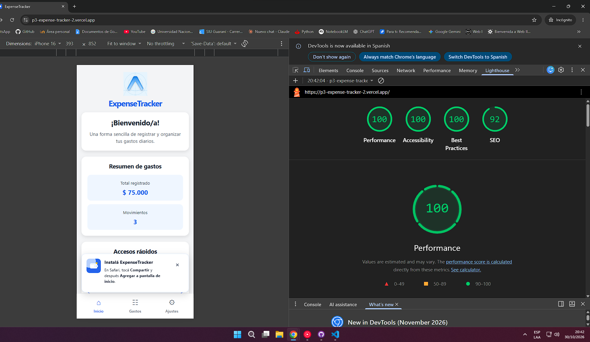

# ExpenseTracker PWA

Versión web (Progressive Web App) de **ExpenseTracker**, migrada desde la app React Native del Sprint 1 (repositorio GastosDiarios-P3). Está hecha con React, Vite y React Router, y se puede instalar en el teléfono y usar sin conexión.

## URL publicada

https://p3-expense-tracker-2.vercel.app

## Cómo ejecutarlo

```bash
npm install
npm run dev
```

El Service Worker solo funciona en la versión de producción. Para probarlo:

```bash
npm run build
npm run preview
```

Después abrí `http://localhost:4173/`.

## Capturas: Expo Go vs. PWA instalada

| Pantalla | Expo Go (React Native) | PWA instalada |
| --- | --- | --- |
| Inicio |  |  |
| Listado de gastos |  |  |
| Detalle del gasto |  |  |
| Ajustes |  |  |
| Formulario de nuevo gasto |  |  |

## Instalación y modo sin conexión

| Ícono en la pantalla de inicio | App funcionando sin conexión (modo avión) |
| --- | --- |
|  |  |

## Informe de Lighthouse (Mobile)

Auditoría ejecutada sobre la versión publicada, en modo Mobile.

| Performance | Accessibility | Best Practices | SEO |
| --- | --- | --- | --- |
| 100 | 100 | 100 | 92 |



## Comparación: React Native (Expo) vs. PWA (React + Vite)

| Aspecto | React Native (Sprint 1) | PWA (Sprint 2) |
| --- | --- | --- |
| Ejecución y distribución | Se prueba con Expo Go en el teléfono | Se abre desde una URL HTTPS y se instala desde el navegador, sin tiendas |
| Componentes de interfaz | `View`, `Text`, `Pressable`, `TextInput` | HTML semántico: `main`, `header`, `section`, `button`, `input`, `dialog` |
| Estilos | `StyleSheet.create()` | Archivos `.css`, con `media queries` para adaptarse al ancho |
| Navegación | React Navigation: Stack y Tab Navigator | React Router: `Routes`, `Outlet` y `NavLink`; cada pantalla tiene su propia URL |
| Datos hacia el detalle | Se envía el objeto completo con `navigation.navigate(..., { gasto })` | Se envía solo el `id` en la URL (`/expenses/:id`) y se lee con `useParams()`; el detalle sigue funcionando al recargar |
| Formulario de alta | Pantalla del Stack con `presentation: 'modal'` | Componente con `<dialog>` + `showModal()` y `createPortal`, con animación de hoja inferior |
| Teclado numérico | `keyboardType="decimal-pad"` | `inputMode="decimal"` |
| Zonas seguras | `SafeAreaView` | `env(safe-area-inset-*)` y `viewport-fit=cover` |
| Íconos | Ionicons de `@expo/vector-icons` | Caracteres Unicode |
| Identidad de la app | `app.json` (nombre, ícono) | `manifest.json` más metaetiquetas para iOS |
| Uso sin conexión | La app se ejecuta de forma local | Requiere un Service Worker (`vite-plugin-pwa`) que guarda los archivos en caché |
| Datos de gastos | Los gastos nuevos se guardan en memoria, en el estado de la app | Se usan datos de ejemplo (`mockExpenses.js`); el sprint no pedía guardar |