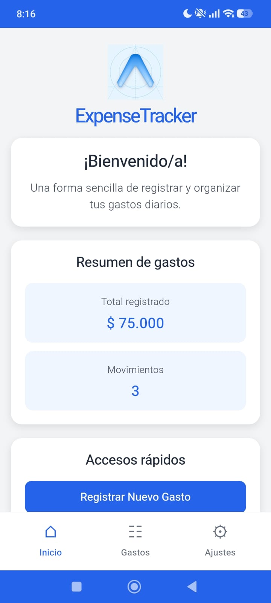
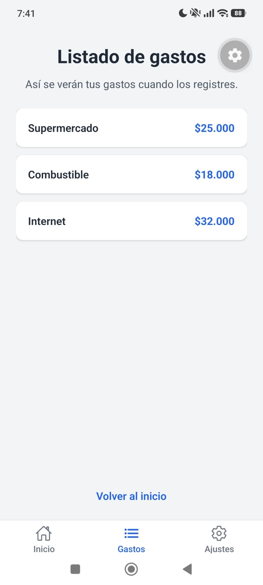
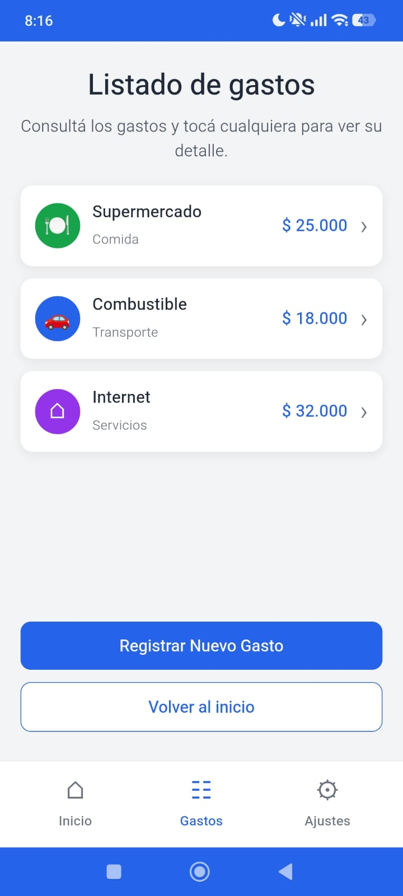
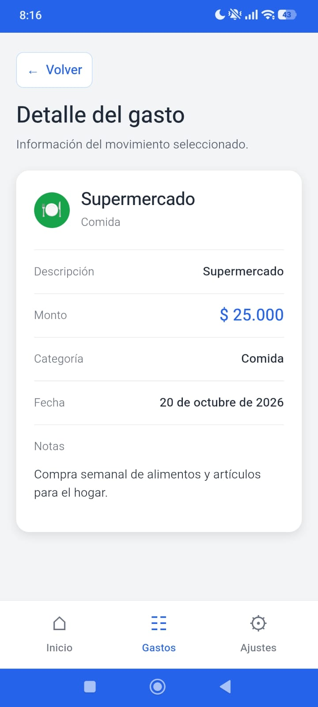
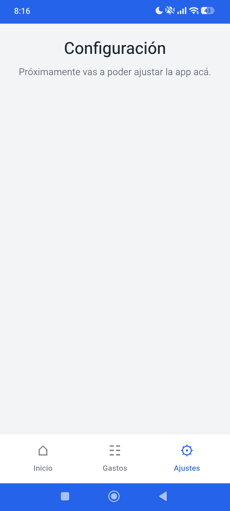
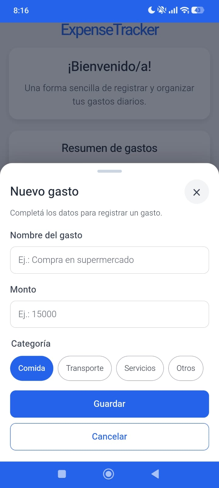
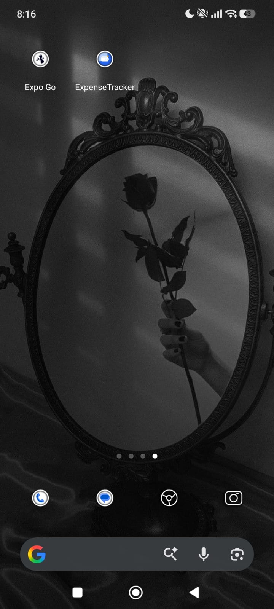
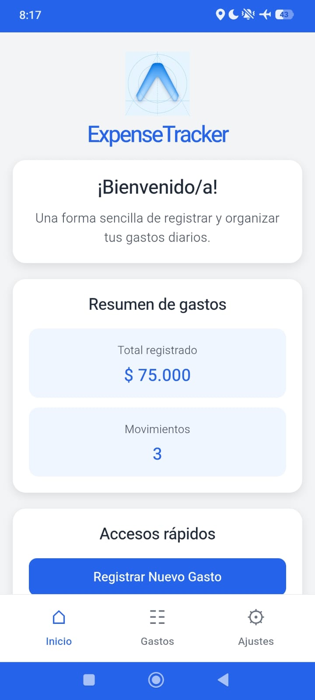

# ExpenseTracker PWA

Versión web (Progressive Web App) de **ExpenseTracker**, migrada desde la app React Native del Sprint 1 (repositorio GastosDiarios-P3). Está hecha con React, Vite y React Router, y se puede instalar en el teléfono y usar sin conexión.

## URL publicada

https://p3-expense-tracker-2.vercel.app

## Cómo ejecutarlo

```bash
npm install
npm run dev
```

El Service Worker solo funciona en la versión de producción. Para probarlo:

```bash
npm run build
npm run preview
```

Después abrí `http://localhost:4173/`.

## Capturas: Expo Go vs. PWA instalada

| Pantalla | Expo Go (React Native) | PWA instalada |
| --- | --- | --- |
| Inicio |  |  |
| Listado de gastos |  |  |
| Detalle del gasto |  |  |
| Ajustes |  |  |
| Formulario de nuevo gasto |  |  |

## Instalación y modo sin conexión

| Ícono en la pantalla de inicio | App funcionando sin conexión (modo avión) |
| --- | --- |
|  |  |